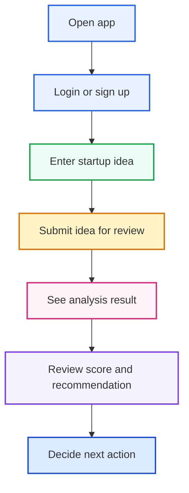
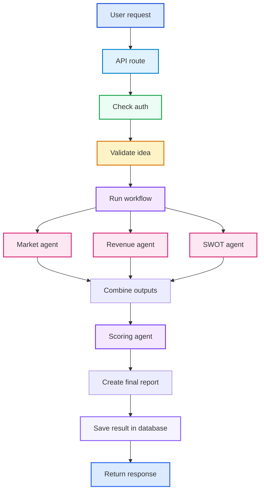
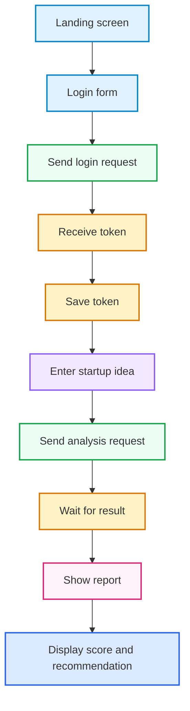
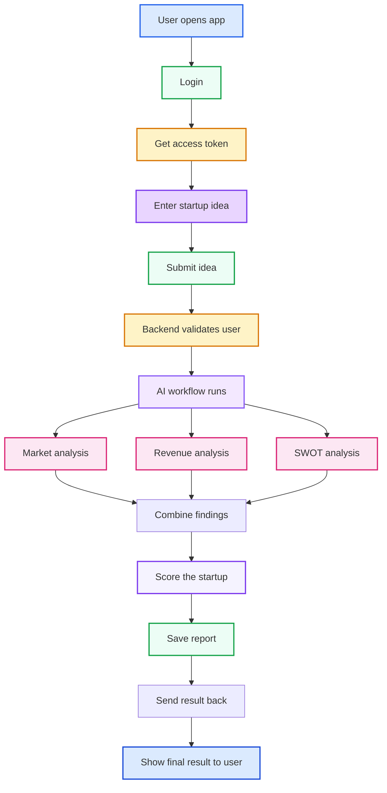

## User Flow

This is the user experience in simple business terms.

## Backend Flow

This shows how the server works behind the scenes.

## Frontend Flow

This shows how the app behaves from the user interface side.

## Integrated Flow

This is the complete end-to-end journey from app start to final result.

## Developer Backend Flow

The app starts in the backend entrypoint: `backend/main.py`.

1. `backend/main.py`
   - loads environment variables with `load_dotenv()`
   - creates the FastAPI app
   - adds CORS
   - registers the API routers:
     - `routes.User_verification`
     - `routes.analyze`

2. `backend/routes/User_verification.py`
   - handles `/signup` and `/login`
   - `signup` calls `create_user()` from `services/user_verification_service.py`
   - `login` checks the user password, then creates a JWT with `create_access_token()` from `services/auth_services.py`

3. `backend/services/auth_services.py`
   - contains password hashing and verification with `passlib` and bcrypt
   - validates JWTs with `get_current_user()`
   - requires `SECRET_KEY` and `ACCESS_TOKEN_EXPIRE_MINUTES` from environment variables

4. `backend/routes/analyze.py`
   - is protected by `Depends(get_current_user)`
   - validates the incoming startup idea
   - calls the graph workflow: `graph.workflow.graph.ainvoke({"idea": ...})`

5. `backend/graph/workflow.py`
   - wires the LangGraph flow together
   - executes the agent chain in order:
     - `agents.market_agent.market_agent`
     - `agents.revenue_agent.revenue_agent`
     - `agents.swot_agent.swot_agent`
     - `agents.scoring_agent.scoring_agent`

6. `backend/database/models.py`
   - defines the SQLAlchemy tables: `User` and `Analysis`
   - `Analysis` stores the user_id, idea, and result payload for a submitted analysis

7. `backend/database/db.py`
   - creates the SQLAlchemy engine and session factory used by routes and services

8. `backend/services/llm.py`
   - creates the LLM instance used by each agent during analysis

Overall flow:

Frontend -> FastAPI route -> Auth service / DB -> LangGraph workflow -> LLM agents -> result saved in PostgreSQL

## Developer Frontend Flow

The frontend is a small React app in the `frontend` folder.

1. `frontend/src/App.tsx`
   - starts on the login screen
   - when the user submits email/password, the login form triggers the auth flow
   - after login, it moves to the input screen where the founder can type the startup idea

2. `frontend/src/api.ts`
   - contains the API calls to the backend
   - `loginUser()` sends a POST request to `/login`
   - `submitIdea()` sends a POST request to `/analyze`

3. Auth flow
   - frontend calls `/login`
   - backend verifies credentials and returns a JWT access token
   - frontend stores the token in memory or browser storage
   - later requests to `/analyze` must include the bearer token in the Authorization header

4. Analysis flow
   - user enters the startup idea and optional metadata
   - `submitIdea()` sends JSON to the backend
   - backend validates the JWT, runs the LangGraph pipeline, and returns analysis data
   - frontend maps the result into display fields such as market score, revenue score, SWOT, evidence, and recommendation

5. Result screen
   - after the analysis finishes, the app switches from the input screen to the output screen
   - scores and recommendations are rendered for the user

In summary:

Login screen -> validate credentials -> receive JWT -> submit idea -> API call to /analyze -> render score report

Code Architecture:

User
 │
 ▼
POST /signup or POST /login
 │ 
 ▼
Route
 │
 ▼
user_verification Service
 │
 ▼
SQLAlchemy
 │
 ▼
PostgreSQL

Authentication actually has two steps.

Step 1: Verify Identity
Email
Password

For this you need to :
Check database.

Every request is independent. So when the user clicks analyze after login the app will not know the user, solution 1: ask for password, credentials with every user api call , solution 2:

Step 2: Remember the User

ways to do this :
Session Authentication
JWT Authentication
Token-based Authentication
OAuth Authentication

JWT Authentication:
the user logs in once.

POST /login
↓
Verify password
↓
Generate JWT

Example response:

{
    "access_token":
    "eyJhbGciOiJIUzI1NiIsInR5cCI6IkpXVCJ9..."
}

Now the frontend stores this token. Now instead of sending password,the frontend sends
Authorization:
Bearer eyJhbGc....
with every request.

SignUp -> store user in DB
Login -> verify password -> generate JWT token -> return to frontend
/analyze -> frontend sends token in header -> backend verifies -> allows/blocks

A JWT is just a string. Internally it has 3 parts: 
Header(has algorithm), 
payload(has the data , no password is there as jwt is stored on frontend which is accessible to everyone), 
signature(encrypted string using a secret key)

WHY 2000 char limit:
LLM tokens : context window needs to be kept in mind, also we are using 4 agents: 2000*4=8000 , slow process beyond it 
abuse prevention : without limit : hangs server

pgAdmin password

Analyze
 ↓
LangGraph
 ↓
Analysis model
 ↓
PostgreSQL

History
 ↓
SELECT analyses
 ↓
Return JSON

APIRouter lets us group related APIs together.
Instead of putting every API inside main.py, we organize them:

routes/

    auth.py
        /signup
        /login

    analyze.py
        /analyze

Postgress connection
Engine and sessions:

postgres: is working on the database url you gave , currently in the code the url is localhost {username}:{password}@localhost/{DB_NAME}

Engine: connection manager, it knows your username, password, host, db name 

Session: suppose 100 users are accessing the app and data at the same time you will not want all of them to share a single connection. We create seperate session for each user.

Python
   |
Engine
   |
PostgreSQL

databse/models.py
Every table
    |
inherits Base

## commands 
cd backend
.\.myenv\Scripts\Activate.ps1
python main.py

cd frontend
npm run dev

{
  "email": "your_email@example.com",
  "password": "your_password"
}