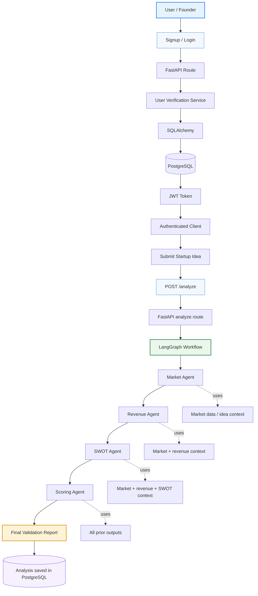

cd backend
.\.myenv\Scripts\Activate.ps1

Code Architecture:

backend
│
├── database
│   ├── db.py
│   └── models.py
│
├── models
│   ├── auth.py
│   └── request.py
│
├── routes
│   ├── analyze.py
│   └── auth.py      
│
├── services
│   ├── auth_service.py
│   └── llm.py
│
├── main.py

User
 │
 ▼
POST /signup or POST /login
 │ 
 ▼
Route
 │
 ▼
user_verification Service
 │
 ▼
SQLAlchemy
 │
 ▼
PostgreSQL

Authentication actually has two steps.

Step 1: Verify Identity
Email
Password

For this you need to :
Check database.

Every request is independent. So when the user clicks analyze after login the app will not know the user, solution 1: ask for password, credentials with every user api call , solution 2:

Step 2: Remember the User

ways to do this :
Session Authentication
JWT Authentication
Token-based Authentication
OAuth Authentication

JWT Authentication:
the user logs in once.

POST /login
↓
Verify password
↓
Generate JWT

Example response:

{
    "access_token":
    "eyJhbGciOiJIUzI1NiIsInR5cCI6IkpXVCJ9..."
}

Now the frontend stores this token. Now instead of sending password,the frontend sends
Authorization:
Bearer eyJhbGc....
with every request.

A JWT is just a string. Internally it has 3 parts: 
Header(has algorithm), 
payload(has the data , no password is there as jwt is stored on frontend which is accessible to everyone), 
signature(encrypted string using a secret key)

pgAdmin password

Analyze
 ↓
LangGraph
 ↓
Analysis model
 ↓
PostgreSQL

History
 ↓
SELECT analyses
 ↓
Return JSON

APIRouter lets us group related APIs together.
Instead of putting every API inside main.py, we organize them:

routes/

    auth.py
        /signup
        /login

    analyze.py
        /analyze

Postgress connection
Engine and sessions:

postgres: is working on the database url you gave , currently in the code the url is localhost {username}:{password}@localhost/{DB_NAME}

Engine: connection manager, it knows your username, password, host, db name 

Session: suppose 100 users are accessing the app and data at the same time you will not want all of them to share a single connection. We create seperate session for each user.

Python
   |
Engine
   |
PostgreSQL

databse/models.py
Every table
    |
inherits Base

## Flow Diagram

